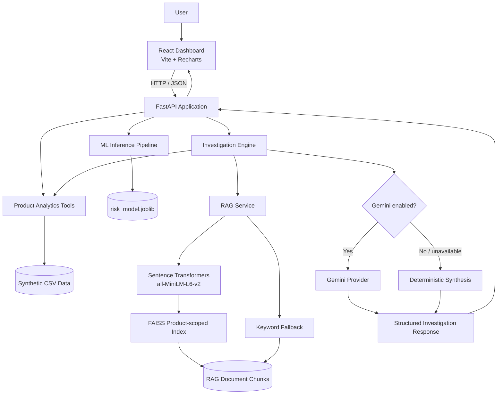

# Product Pulse — Architecture

## 1. Architectural overview

Product Pulse uses a two-service web application supported by local data and model artifacts:

- **Frontend:** React application built with Vite and Recharts.
- **Backend:** FastAPI application that exposes portfolio, product, and investigation endpoints.
- **Analytics and ML:** Pandas/NumPy-based data access and a scikit-learn classification pipeline.
- **Retrieval and synthesis:** product-scoped Sentence Transformers + FAISS retrieval, optional Gemini generation, and deterministic fallback synthesis.
- **Runtime:** Docker Compose for the API and frontend services.

## 2. Component diagram

The diagram represents the logical application flow. Keyword fallback is used when semantic retrieval cannot be initialized; deterministic synthesis is used when the optional LLM provider is disabled or generation fails.

## 3. Data and model artifacts

Important repository paths:

| Path | Responsibility |
|---|---|
| `data/processed/` | Generated product, customer, order, return, review, ticket, monthly metric, label, and prediction tables |
| `data/rag/` | Knowledge chunks and RAG evaluation query/result files |
| `models/risk_model.joblib` | Serialized scikit-learn preprocessing and classification pipeline |
| `scripts/generate_data.py` | Reproducible synthetic data generation |
| `scripts/validate_data.py` | Data contract and integrity validation |
| `scripts/train_model.py` | Feature engineering, chronological evaluation, model selection, and serialization |
| `scripts/evaluate_rag.py` | Curated keyword retrieval smoke evaluation |
| `src/analytics/product_tools.py` | Product, trend, support, and portfolio data access |
| `src/rag/` | Retrieval, prompt construction, LLM provider, schema, and investigation orchestration |
| `api/main.py` | FastAPI application and HTTP endpoints |
| `frontend/src/` | React dashboard and styles |

## 4. Request flows

### 4.1 Portfolio and product views

1. The React dashboard calls the relevant FastAPI endpoint.
2. The API delegates to read-only analytics functions.
3. Analytics functions load the prepared CSV tables and calculate or return the requested KPIs.
4. The API serializes the results as JSON for the frontend.

### 4.2 Risk prediction

1. Monthly metrics are transformed into model features during training.
2. Numeric values are imputed and standardized; category and brand values are imputed and one-hot encoded.
3. A selected scikit-learn pipeline is saved as `models/risk_model.joblib`.
4. At inference time, the risk endpoint returns product-level risk information and the model's predicted next-month high-risk probability and prediction metadata.

### 4.3 Product investigation

1. The client posts a `product_id` and a natural-language `question` to `/investigate`.
2. The investigation engine obtains product risk, recent monthly trends, and a support-ticket summary from analytics tools.
3. The RAG service retrieves up to five relevant chunks scoped to the requested product.
4. If Gemini is configured, the provider requests a JSON response using the evidence and retrieved sources. Otherwise, or if generation fails, deterministic synthesis produces a fallback response.
5. The engine validates the response against the Pydantic response schema and filters source references to retrieved documents.
6. The API returns the generated response, raw business evidence, retrieval mode, generation mode, and retrieved source chunks.

### 4.4 Retrieval fallback behavior

- **Semantic path:** Sentence Transformers creates normalized embeddings; FAISS inner-product search ranks the product-specific chunks.
- **Keyword path:** a local token-overlap retriever ranks product-specific chunks when the semantic retriever or model cannot be loaded.
- The application reports the selected retrieval mode in the investigation response.

## 5. Runtime and deployment

Docker Compose defines two services:

| Service | Container port | Host port | Purpose |
|---|---:|---:|---|
| API | 8000 | 8000 | FastAPI backend and health check |
| Frontend | 4173 | 4173 | Built React application served to the browser |

The API health check is available at `GET /health`. The frontend uses the API base URL configured for its build/runtime environment. CORS origins are configured through `CORS_ALLOW_ORIGINS`.

## 6. Configuration and secrets

| Variable | Purpose | Default / example |
|---|---|---|
| `APP_ENV` | Runtime environment label | `development` in the Compose definition |
| `PRODUCT_PULSE_LLM` | Select LLM mode | `none` |
| `GEMINI_API_KEY` | Gemini API credential | Not set by default |
| `GEMINI_MODEL` | Gemini model identifier | `gemini-3.5-flash-lite` |
| `CORS_ALLOW_ORIGINS` | Comma-separated allowed browser origins | Local Vite and Docker frontend origins |
| `LOG_LEVEL` | Application logging level | `INFO` |

Secrets must be provided through a local environment file or deployment secret store. Do not commit `.env` or credentials.

## 7. Design considerations

- **Reproducibility:** fixed-seed data generation enables repeatable local demos.
- **Graceful degradation:** keyword retrieval and deterministic synthesis keep the core investigation workflow available when semantic or LLM components are unavailable.
- **Product scoping:** retrieval is constrained to the selected product to reduce unrelated document matches.
- **Traceability:** investigation responses expose retrieved source identifiers and raw evidence.
- **Separation of concerns:** frontend, HTTP API, analytics, ML, retrieval, and synthesis are implemented in separate modules.

## 8. Known limitations

The architecture is a local capstone prototype, not a production deployment blueprint. The data is synthetic, the model has not been validated against real-world data, and the RAG/LLM evaluation is limited. Provider availability, model access, and quotas are external dependencies when Gemini mode is enabled.
